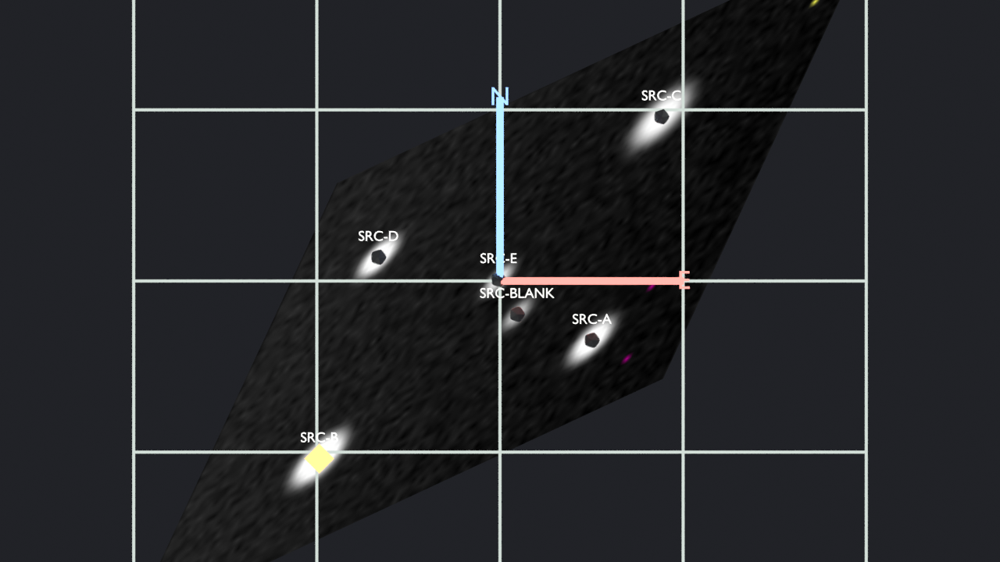

# WCSScene



Synthetic 96×80 field, rotated TAN WCS, rendered in Blender 4.5.14. North is the blue axis, east is the red axis, and the yellow marker is catalogue row `SRC-B`. This is not a telescope observation.

WCSScene turns a calibrated 2D image, its World Coordinate System, and an optional source catalogue into a Blender scene whose positions can be checked against that WCS. The scene is a 2.5D presentation. A single exposure gives directions on the sky, not distances, so markers stay on the presentation plane with `distance_unknown`.

## Install

```bash
python3.12 -m venv .venv
source .venv/bin/activate
python -m pip install -e ".[roman,dev]"
```

Details, the Blender extension zip, and the background importer are in [docs/installation.md](docs/installation.md).

## 60-second demo

```bash
wcsscene demo --out build/demo
wcsscene validate build/demo/manifest.json --report build/demo/validation.json
blender --background --python-exit-code 7 \
  --python scripts/import_bundle.py -- build/demo \
  --save build/demo_scene.blend --render build/demo_scene.png
```

`build/demo/qa_report.md` is the numerical check. On the tested run of this fixture:

- world/pixel round-trip max error `2.25e-10` pixel (tolerance `1e-3` pixel)
- mesh interpolation max residual `1.41e-10` arcsec (budget `0.025` arcsec)
- `SRC-B` is catalogue row 1, pixel centre `(70, 18)`, sky `(149.9956429351878°, -20.004026964561074°)`, scene `(-14.739109, -14.497264, 0)` Blender units

Open the sidebar category **WCSScene** in the 3D Viewport to read the same source from the marker. Z = 0 is the plane, not a distance.

The same field is also prepared without relying on `demo`:

```bash
wcsscene inspect examples/reference.fits --hdu SCI
wcsscene prepare examples/reference.fits --hdu SCI \
  --catalog examples/reference_sources.ecsv \
  --projection tan --arcsec-per-bu 1.0 --highlight SRC-B \
  --out build/reference
wcsscene validate build/reference/manifest.json --report build/reference/validation.json
wcsscene prepare examples/synthetic_no_wcs.npz --pixel-preview --out build/pixel-preview
wcsscene doctor
```

`--arcsec-per-bu 1` means one Blender unit is one arcsecond on the tangent plane. `--hdu ERR` exits 2 and lists the HDUs. `examples/roman_calibrated.asdf` is not shipped; that command exits 2 with `INVALID_INPUT`. A library-only Roman path is documented in [docs/roman-asdf.md](docs/roman-asdf.md).

## Supported inputs

| Input | Scientific placement |
| --- | --- |
| 2D FITS image with a celestial FITS WCS, including SIP | Yes. HDU by name or index. |
| CSV, ECSV, or FITS table with pixel and/or sky columns | Yes, after an authority check. |
| NGRST-style columns (`label`, `x_centroid`, `y_centroid`, `ra`, `dec`, `snr`, `anomaly_score`, `anomaly_percentile`, `known`, `reference_id`) | Accepted when present. Blanks stay blank. |
| Roman `ImageModel` / `MosaicModel` ASDF with `meta.wcs` | Yes, if the `roman` extra is installed. Not a claim of flight data. |
| Image with no WCS | Refused, unless `--pixel-preview` is explicit. |
| WCS that is not 2D celestial | Refused. Axes are not dropped. |

## Versions exercised

| Piece | Version |
| --- | --- |
| Python | 3.12.3 |
| NumPy | 2.5.4 |
| Astropy | 8.0.1 |
| GWCS | 1.0.3 |
| asdf | 5.4.0 |
| roman_datamodels | 1.2.0 |
| Blender | 4.5.14 LTS, hash `62c1db4208e8` |

The full pin list is `requirements-tested.txt`.

## Limitations

Read [docs/scientific-limitations.md](docs/scientific-limitations.md) before treating a render as a measurement. In short: numerical agreement with the supplied WCS is not absolute accuracy on the sky; the display stretch is not photometry; anomaly scores are not detections; missing uncertainties stay `UNKNOWN`.

## Acceptance status

| # | Check | Result on this build |
| --- | --- | --- |
| 1 | Pixel centres are zero-based; `CRPIX` stays 1-based | Pass |
| 2 | World/pixel round-trip | Pass, `2.25e-10` px on the TAN fixture |
| 3 | North/east, mirrored CD, RA seam | Pass |
| 4 | SIP is not an affine plane; a 1-cell mesh fails the residual budget | Pass |
| 5 | ICRS, FK5, Galactic labels; extra axes rejected | Pass |
| 6 | Catalogue agreement, deliberate disagreement, blank sky, outside footprint | Pass |
| 7 | Missing WCS fails closed; pixel preview makes no sky claim | Pass |
| 8 | Covariance Jacobian; absent errors are `UNKNOWN` | Pass |
| 9 | NaNs, DQ flags, saturation, log stretch refusal | Pass |
| 10 | Stable `content_id`, geometry bytes, and input hashes | Pass |
| 11 | Roman `meta.wcs` round-trip on `create_fake_data` | Pass as a library fixture only. Flight products and CRDS distortion were not verified. A missing dependency is exit 5. |
| 12 | Blender 4.5 import, `SRC-B` position, save, reimport, `KeepMe` preserved | Pass. Screenshot above. |
| 13 | 1100×900 image, 2000 markers, display capped | Pass in 7.48 s, tracemalloc peak 25.9 MB, display 180×220, 525 mesh vertices, one marker object |

## Layout

The scientific code is `src/wcsscene`. The Blender extension is `blender_addon/wcsscene`. Contracts live in [docs/coordinate-contract.md](docs/coordinate-contract.md). CLI text is [docs/cli.md](docs/cli.md). Prior art is [docs/prior-art.md](docs/prior-art.md).

## Licence

The scientific package and the extension source are MIT. See [LICENSE](LICENSE). Blender is GPL-2.0-or-later, which applies when the add-on runs inside Blender.
